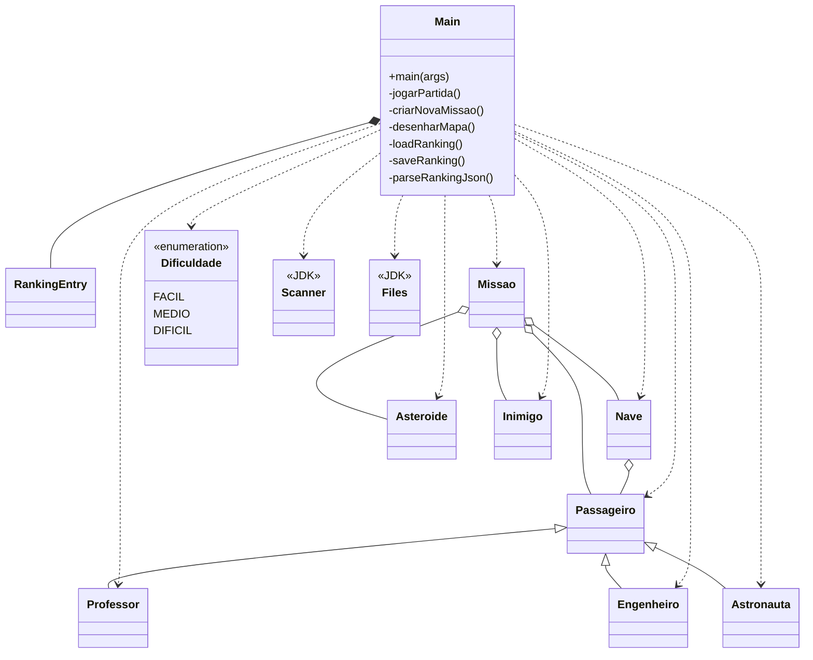
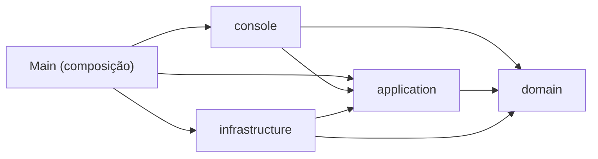

# Fase 0: arquitetura atual e proposta de camadas

Aluno: Matheus Correia · Data: 14/11/2026 · Issue #3
Código analisado: `fases/fase-00-console/src` (`Main.java` com 569 linhas). As linhas citadas são as do `Main.java`.

## 1. Responsabilidades concentradas no `Main`

O `Main` tem dez motivos diferentes para mudar.

| # | Responsabilidade | Métodos e trechos | Para onde vai |
| --- | --- | --- | --- |
| 1 | Composição e menu | `main` 26-62, `exibirBoasVindas` 64-70, `exibirMenu` 72-79 | `Main` (só composição) e `console` |
| 2 | Leitura e validação da entrada | `lerLinha` 394-402, `lerDificuldade` 228-232, `lerTamanhoMapa` 234-242, leitura e despacho do comando 118-153 | `console` (leitura) e `Acao` (`application`) |
| 3 | Regras do turno | `jogarPartida` 111-209: embarque 132-145, movimento 146-149, inimigos 155-156, colisão 158-167, pontuação 169-173, vitória 175-208 | `GameSession` |
| 4 | Estado da partida (pontos, movimentos, tempo) | variáveis locais 105-109 | `GameSession` |
| 5 | Parâmetros por dificuldade | `definirPontuacaoInicial` 244-250, quantidades 256-268 | `Dificuldade` |
| 6 | Criação do cenário | `criarNovaMissao` 252-302, `criarPassageiroPolimorfico` 304-312, `posicaoOcupada` 314-326 | `MissaoFactory` (ocupação na `Missao`) |
| 7 | Desenho e mensagens | `desenharMapa` 328-392, `exibirEstatisticas` 212-226, `exibirRankingCompleto` 404-416, textos dentro de `jogarPartida` | `console` |
| 8 | Regra do Top 5 | `isTopScore` 434-439, ordenação e corte 187-203, recorde 219-224 | `application` |
| 9 | Persistência do ranking | `loadRanking` 441-451, `saveRanking` 453-481, `parseRankingJson` 483-550, arquivo apagado em `resetarRanking` 418-432 | `infrastructure` |
| 10 | Registro de uma entrada do ranking | classe interna `RankingEntry` 552-568 | `application` |

## 2. Problemas de acoplamento e violações de SOLID

| # | Princípio | Local | Problema e impacto | Proposta | Prioridade |
| --- | --- | --- | --- | --- | --- |
| 1 | SRP | `Main` inteiro | Dez motivos para mudar; mexer no formato do ranking exige abrir o mesmo arquivo que controla a partida | Dividir pelas quatro camadas | alta |
| 2 | DIP | `RANKING_PATH` 24, 418-432, 441-481 | A regra do jogo depende de `Files`, `Path` e do formato do arquivo; trocar o armazenamento ou testar sem disco exige alterar o `Main` | `RankingRepository` em `application` | alta |
| 3 | OCP | `criarPassageiroPolimorfico` 304-312 e `desenharMapa` 351-357 (`instanceof`) | Um novo tipo de passageiro obriga a editar dois lugares | Cada passageiro informa o próprio símbolo | alta |
| 4 | Acoplamento à interface | regras do turno 111-209 | As regras usam `System.out` e `Scanner` e não podem ser testadas sem terminal | `GameSession` devolve um resultado do turno | alta |
| 5 | OCP | `definirPontuacaoInicial` 244-250 e 260-268 | Uma nova dificuldade exige editar um `switch` e um `if/else` | Parâmetros dentro do enum `Dificuldade` | média |
| 6 | Conhecimento do mapa espalhado | quatro inteiros de limites passados a quatro métodos; base (0,0) repetida em 177, 274 e 377; coordenadas comparadas à mão em 314-326 e 346-379 | Qualquer mudança no mapa se espalha | `Mapa` e `Base`; cada elemento informa a própria posição | média |
| 7 | Duplicação | três laços de sorteio 270-299; `colideCom` idêntico em `Asteroide` e `Inimigo` | Ajustar o sorteio exige três alterações | Um único sorteio de célula livre na `MissaoFactory` | média |
| 8 | Encapsulamento | `Missao` devolve as listas internas e o `Main` lê as coordenadas de cada item | Quem usa decide a regra | `Missao` expõe operações, não listas | média |
| 9 | Aleatoriedade | `new Random()` em 28, repassado | Testes dependem da sorte | `Random` injetado por construtor | média |
| 10 | LSP / hierarquia | `Passageiro` | É concreta, com o tipo em `String` e pontuação padrão 10; as subclasses só trocam a pontuação | `Passageiro` abstrata | baixa |

## 3. Arquitetura atual

O `Main` conhece todas as classes do jogo e ainda fala direto com o teclado e com o disco; as demais classes são só dados com poucas regras.

## 4. Proposta de organização em camadas

| Camada | Classes | Observações |
| --- | --- | --- |
| `domain` | `Posicao`, `Mapa`, `Base`, `Nave`, `Passageiro` (abstrata), `Professor`, `Engenheiro`, `Astronauta`, `Asteroide`, `Inimigo`, `Missao` | Sem aleatoriedade, sem entrada nem saída. Cada elemento do mapa informa a própria posição e o próprio símbolo. O `Mapa` guarda só tamanho e limites; a ocupação fica na `Missao` |
| `application` | `Acao` (enum), `Dificuldade` (com parâmetros), `GameSession`, resultado do turno, `MissaoFactory`, `RankingRepository` (interface), `RankingEntry`, regra do Top 5 | Não importa `console` nem `infrastructure`. A `GameSession` recebe uma `Acao` e devolve o resultado do turno |
| `console` | Menu e laço do jogo, leitura dos comandos, desenho do mapa, tradução do resultado do turno em mensagens | Sem regra de jogo; as frases continuam as da Fase 0 |
| `infrastructure` | Implementação em arquivo do `RankingRepository` (JSON escrito e lido à mão) | Implementa a interface de `application` |
| raiz | `Main` de composição | Cria o `Random`, o repositório, a fábrica e a sessão, e inicia o jogo |

Regras de dependência: `domain` não importa nenhuma outra camada; `application` importa só `domain`; `console` e `infrastructure` importam `application` e `domain`; só o `Main` enxerga todas.

## 5. Decisões de arquitetura

1. `RankingRepository` e o registro de entrada ficam em `application`; o arquivo JSON fica em `infrastructure`.
2. A `Dificuldade` fica em `application` e carrega a pontuação inicial e as três quantidades; a `MissaoFactory` só lê esses valores.
3. O `Mapa` é uma classe própria no `domain`, com tamanho, limites e "esta posição está dentro do mapa?".
4. A ocupação de células fica na `Missao`; o sorteio de células livres, na `MissaoFactory`.
5. A `GameSession` recebe uma `Acao` e devolve o resultado do turno; o `console` o traduz nas mesmas frases da Fase 0.
6. O `Random` é injetado por construtor na `MissaoFactory` e na `GameSession`.
7. Os pontos de atenção da análise da Fase 0 são preservados, exceto as mudanças exigidas pela Fase 1 (desembarque na base, vitória por passageiros entregues, indicadores a bordo + entregues + restantes = total, capacidade coerente) (a `Acao` continua usando só o primeiro caractere do comando; o JSON continua manual).

Fora de escopo: eventos com ouvinte entre sessão e console (Fase 3), configuração de dificuldade em arquivo, `Mapa` controlando ocupação ou sorteio.

Pendências para as próximas issues: incluir o `Mapa` na lista de entidades da #4; detalhar na #5 o formato do resultado do turno e a classe da regra do Top 5.

## 6. Critérios de aceite da issue #3

- [x] Tabela com as responsabilidades concentradas no `Main` (seção 1)
- [x] Problemas de acoplamento e violações de SOLID identificados (seção 2)
- [x] Diagrama da arquitetura atual em Mermaid (seção 3)
- [x] Proposta de organização em camadas (seção 4)
