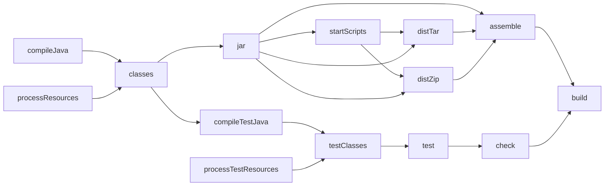

# Fase 2: migração para Gradle e testes JUnit 5

Issues: #8 (Gradle e Wrapper 8.7), #9 (testes JUnit 5), #10 (este documento).

Código: [`fases/fase-02-gradle/`](../fases/fase-02-gradle/). Como executar: [README da fase](../fases/fase-02-gradle/README.md).

## 1. O que mudou e o que não mudou

A Fase 1 compilava com um `build.sh` que chamava o `javac` direto: não tinha onde declarar dependências nem rodar testes. A Fase 2 coloca o **mesmo código** num projeto Gradle:

| | Fase 1 | Fase 2 |
|---|---|---|
| Código do jogo | `src/missaomarte/**` | `src/main/java/missaomarte/**` (**idêntico**, conferido por hash) |
| Testes | nenhum (roteiro manual) | `src/test/java/missaomarte/**`, 75 testes JUnit 5 |
| Build | `build.sh` (`javac` + `java`) | `build.gradle` + Gradle Wrapper 8.7 |
| Dependências | nenhuma | nenhuma em execução; JUnit só nos testes |

Nenhuma regra, frase ou comportamento do jogo mudou.

## 2. Passo a passo da migração

1. Criar `fases/fase-02-gradle/` e copiar `fases/fase-01-refatoracao/src/` para `src/main/java/`, sem alterar nenhum byte.
2. Escrever `settings.gradle` (nome do projeto) e `build.gradle` em DSL Groovy:
   ```groovy
   plugins { id 'application' }
   repositories { mavenCentral() }
   java { sourceCompatibility = JavaVersion.VERSION_17; targetCompatibility = JavaVersion.VERSION_17 }
   tasks.withType(JavaCompile).configureEach { options.encoding = 'UTF-8'; options.release = 17 }
   dependencies {
       testImplementation platform('org.junit:junit-bom:5.10.3')
       testImplementation 'org.junit.jupiter:junit-jupiter'
       testRuntimeOnly 'org.junit.platform:junit-platform-launcher'
   }
   application { mainClass = 'missaomarte.Main' }
   run { standardInput = System.in }
   test { useJUnitPlatform() }
   ```
3. Gerar o Wrapper com um Gradle qualquer, uma única vez: `gradle wrapper --gradle-version 8.7 --distribution-type bin`. Versionar `gradlew`, `gradlew.bat` e `gradle/wrapper/*`.
4. Criar o `.gitignore` da fase (`build/`, `.gradle/`, `out/`, `ranking.json`).
5. Criar `scripts/comparar-hash.sh` para provar que o código não mudou.
6. Escrever os testes em `src/test/java`, nos mesmos pacotes das classes testadas.
7. Conferir: `./gradlew --version`, `clean build`, `test`, `run`, `installDist`, o hash e o gate `.workflow/check.sh`.

## 3. Tasks e o grafo de tarefas (DAG)

No Gradle, o build é um conjunto de **tarefas** (*tasks*) ligadas por dependências. Essas ligações formam um **grafo dirigido acíclico** (DAG): uma tarefa só roda depois das que ela precisa, e não pode haver ciclo. Ao pedir `./gradlew build`, o Gradle monta o grafo e executa só o necessário, pulando o que já está atualizado (`UP-TO-DATE`).

Saída real de `./gradlew build --dry-run` nesta fase, na ordem de execução:

```text
:compileJava → :processResources → :classes → :jar → :startScripts → :distTar → :distZip → :assemble
→ :compileTestJava → :processTestResources → :testClasses → :test → :check → :build
```



Consequência prática: se um teste falhar, `check` falha e o `build` também. É por isso que o gate do time roda `./gradlew clean build`: compila e testa de uma vez.

## 4. O plugin `application`

O plugin `application` (que já aplica o plugin `java`) transforma o projeto num programa executável:

- `mainClass = 'missaomarte.Main'` diz qual classe tem o `main`.
- **`run`**: compila e executa o jogo. Por padrão a tarefa não repassa o teclado ao programa; por isso `run { standardInput = System.in }`. Sem isso, o `Scanner` do console recebe fim de entrada na hora e o jogo encerra.
- **`startScripts`**, **`distZip`**, **`distTar`** e **`installDist`**: geram scripts de inicialização (`bin/missao-marte` e `bin/missao-marte.bat`) com o classpath já montado. `./gradlew installDist` deixa tudo em `build/install/missao-marte/`, pronto para rodar sem Gradle.

`--console=plain` no `run` evita que a barra de progresso do Gradle se misture com o texto do jogo.

## 5. Escopos de dependência

Cada dependência é declarada numa **configuração**, que diz em que momento ela é usada:

| Configuração | Entra na compilação do código | Entra na execução do jogo | Entra nos testes | Uso aqui |
|---|---|---|---|---|
| `implementation` | sim | sim | sim | nenhuma (o jogo não depende de nada) |
| `runtimeOnly` | não | sim | sim | nenhuma |
| `testImplementation` | não | não | compila e executa | JUnit Jupiter (API e motor), via BOM |
| `testRuntimeOnly` | não | não | só executa | `junit-platform-launcher` (o Gradle usa para disparar os testes) |

O **BOM** (`platform('org.junit:junit-bom:5.10.3')`) fixa a versão de todos os artefatos do JUnit num lugar só; por isso `junit-jupiter` aparece sem versão.

Evidência de que o jogo não tem dependência de execução:

```text
$ ./gradlew dependencies --configuration runtimeClasspath
runtimeClasspath - Runtime classpath of source set 'main'.
No dependencies

$ ./gradlew dependencies --configuration testRuntimeClasspath
+--- org.junit:junit-bom:5.10.3
+--- org.junit.jupiter:junit-jupiter -> 5.10.3
\--- org.junit.platform:junit-platform-launcher -> 1.10.3
```

## 6. Wrapper vs Gradle instalado

| | Gradle instalado (`gradle`) | Wrapper (`./gradlew`) |
|---|---|---|
| Versão | a que cada pessoa tiver na máquina | fixada em `gradle-wrapper.properties` (8.7) |
| Instalação | cada integrante instala | nenhuma: o script baixa a versão certa na primeira vez e guarda em `~/.gradle/wrapper/dists` |
| Reprodutibilidade | builds diferentes em máquinas diferentes | todos (e o gate) usam exatamente a mesma versão |

O Wrapper são quatro arquivos versionados: `gradlew` (macOS/Linux), `gradlew.bat` (Windows), `gradle/wrapper/gradle-wrapper.jar` (o programa que baixa o Gradle) e `gradle/wrapper/gradle-wrapper.properties`:

```text
distributionUrl=https\://services.gradle.org/distributions/gradle-8.7-bin.zip
```

O Gradle instalado só foi usado uma vez, para gerar o Wrapper. Depois disso, tudo usa `./gradlew`.

## 7. Ciclo de vida do build

Toda execução do Gradle passa por três fases:

1. **Inicialização:** lê o `settings.gradle` e descobre quais projetos fazem parte do build (aqui, um só: `missao-marte`).
2. **Configuração:** executa o `build.gradle`, aplica os plugins e monta o grafo de tarefas. Nenhuma tarefa roda ainda; o `--dry-run` para aqui e só mostra o plano.
3. **Execução:** roda as tarefas pedidas e as dependências delas, na ordem do grafo, pulando as que estão atualizadas.

Os plugins `java`/`application` também trazem as tarefas de ciclo de vida, que não fazem trabalho próprio e só agrupam outras: `assemble` (empacota), `check` (verifica, inclui `test`) e `build` (`assemble` + `check`). `clean` apaga a pasta `build/`.

## 8. Testes JUnit 5

Os testes ficam em `src/test/java`, nos mesmos pacotes das classes testadas. Cada método tem no nome o critério da spec `fase2-testes-junit` que ele prova (ex.: `r5_8_duasDerrotasNaOrdem`) e um `@DisplayName` em português para o relatório.

### Dublês escritos à mão (sem Mockito)

O código da Fase 1 já recebe tudo pelo construtor (injeção de dependência), então os testes trocam as peças sem mudar uma linha do jogo:

| Dublê | Para quê |
|---|---|
| `FabricaFixa extends MissaoFactory` | Devolve uma `Missao` montada no teste (nave, passageiros e perigos em posições conhecidas) |
| `RelogioControlado extends Clock` | O teste avança o tempo e prova que a duração congela no fim |
| `RandomSequencia extends Random` | Fixa a direção sorteada dos inimigos |
| `RankingEmMemoria` / `RankingQueFalha` | Implementam `RankingRepository` sem arquivo, e simulando falha |

O `FileRankingRepository` é testado com `@TempDir`: o JUnit cria uma pasta temporária e a apaga no fim, então nenhum teste grava fora dela. Nenhum teste lê o teclado nem depende do relógio real ou de `Random` sem semente.

### O que cada classe de teste cobre

| Classe | Testes | O que prova |
|---|---|---|
| `PosicaoTest` | 2 | Mover devolve nova instância; `equals`/`hashCode` por coordenadas |
| `MapaTest` | 2 | Bordas dentro do mapa, posições de fora não |
| `NaveTest` | 4 | Parada na borda; embarque até a capacidade e nave cheia; desembarque libera espaço; vidas não ficam negativas |
| `AcaoTest` | 20 | `w/s/a/d/c/q` em maiúscula e minúscula; só o 1º caractere conta (`sair` → BAIXO); vazio, nulo e outros → INVALIDA |
| `DificuldadeTest` | 15 | Parâmetros das 3 dificuldades; texto com e sem acento; nomes de exibição |
| `MissaoFactoryTest` | 6 | Quantidades e capacidade por dificuldade; nenhum objeto na mesma célula nem na base (50 sementes × 5 tamanhos × 3 dificuldades); sequência de nomes; mesma semente, mesmo cenário |
| `GameSessionTest` | 16 | Início e piloto anônimo; movimento e borda; embarque e as duas recusas; entrega automática; conta dos indicadores; colisão e nave destruída; as duas derrotas no mesmo turno; ponto *h*; vitória só com todos entregues; ordem dos eventos; INVALIDA e SAIR; inimigo; duração congelada; resumo |
| `RankingTop5Test` | 6 | Recusa derrota e pontos ≤ 0; limite de 5 (empate com o último não entra); ordem e empate; data do `Clock`; recorde; falha propagada |
| `FileRankingRepositoryTest` | 4 | Gravar e ler de volta; arquivo inexistente; limpar apaga; lê o `ranking.json` da Fase 0 |

## 9. Resultado dos testes

Executado em 2026-11-20, com `./gradlew clean build` no JDK 17.0.21 (Temurin) e Gradle 8.7:

```text
missaomarte.application.AcaoTest                               tests=20 failures=0 errors=0 skipped=0
missaomarte.application.DificuldadeTest                        tests=15 failures=0 errors=0 skipped=0
missaomarte.application.GameSessionTest                        tests=16 failures=0 errors=0 skipped=0
missaomarte.application.MissaoFactoryTest                      tests=6  failures=0 errors=0 skipped=0
missaomarte.application.RankingTop5Test                        tests=6  failures=0 errors=0 skipped=0
missaomarte.domain.MapaTest                                    tests=2  failures=0 errors=0 skipped=0
missaomarte.domain.NaveTest                                    tests=4  failures=0 errors=0 skipped=0
missaomarte.domain.PosicaoTest                                 tests=2  failures=0 errors=0 skipped=0
missaomarte.infrastructure.ranking.FileRankingRepositoryTest   tests=4  failures=0 errors=0 skipped=0

75 testes, 0 falhas, menos de 1 s de execução dos testes. BUILD SUCCESSFUL.
```

Nenhum teste revelou bug no código da Fase 1.

## 10. Comparação por hash

`scripts/comparar-hash.sh` calcula o SHA-256 de cada `.java` nas duas fases. Resumo da execução (a lista completa tem uma linha por arquivo, com os dois hashes e `OK`):

```text
missaomarte/Main.java  …  OK
missaomarte/application/Acao.java  …  OK
…
missaomarte/infrastructure/ranking/FileRankingRepository.java  9d5571ea2622  9d5571ea2622  OK

33 arquivos comparados: todos idênticos      (código de saída 0)
```

Prova do caso negativo, numa cópia temporária com uma linha acrescentada ao `Mapa.java` (não commitada):

```text
missaomarte/domain/Mapa.java  b52f60421e57  72a6a487f75b  DIFERENTE

33 arquivos comparados: 1 com problema       (código de saída 1)
```

`git diff main --stat -- fases/fase-00-console fases/fase-01-refatoracao` não mostra nada: as Fases 0 e 1 não foram alteradas.

## 11. Comandos conferidos

| Comando | Resultado |
|---|---|
| `./gradlew --version` | Gradle 8.7, JVM 17.0.21.1 (Eclipse Adoptium) |
| `./gradlew clean build` | BUILD SUCCESSFUL, 75 testes |
| `./gradlew test` | BUILD SUCCESSFUL |
| `./gradlew run --console=plain` | Menu, ranking e partida com os textos da Fase 1; o teclado chega ao jogo |
| `./gradlew installDist` | `build/install/missao-marte/bin/missao-marte` e `.bat`; o script inicia o jogo |
| `git status` | `build/`, `.gradle/` e `ranking.json` não aparecem |
| `.workflow/check.sh` | tudo passou (Fase 0 intacta, Fase 1 javac, Fase 2 `gradlew clean build`, regras de camadas) |

## 12. Problemas encontrados

1. **JDK incompatível:** a máquina usada só tinha o JDK 26, e o Gradle 8.7 não roda nele ("Unsupported class file major version"). Solução: usar um JDK 17 apontado pelo `JAVA_HOME`. O README da fase explica como.
2. **Gradle não instalado:** o Wrapper precisa de um Gradle para ser gerado na primeira vez. Foi usado um Gradle 8.7 temporário só para rodar `gradle wrapper`; depois disso, só `./gradlew`.
3. **Teclado no `run`:** sem `standardInput = System.in`, o jogo recebe fim de entrada na hora e encerra com "Entrada encerrada. Obrigado por jogar!".
4. **Saída do Gradle misturada com o jogo:** a barra de progresso aparece no meio do mapa. Solução: `./gradlew run --console=plain`.
5. **Inimigos aleatórios nos testes:** testar colisão com inimigo dependeria do sorteio. Solução: colisões testadas com asteroides (parados) e um `Random` com sequência fixa para o movimento dos inimigos.
6. **Situações difíceis de alcançar** (por exemplo, a nave destruída e a pontuação zerando no mesmo turno): procurar uma semente que gerasse a situação deixaria o teste frágil. Solução: a `FabricaFixa` monta a missão exata, num mapa pequeno, e o teste joga os turnos.
