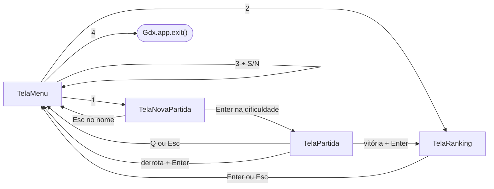

# Fase 3: libGDX, telas e ranking Top 10

Issues: #14 (estrutura libGDX e telas), #15 (`RankingService`), #16 (tela da Partida) e #35 (este documento).

Código: [`fases/fase-03-libgdx/`](../fases/fase-03-libgdx/). Como executar: [README da fase](../fases/fase-03-libgdx/README.md).

## 1. Módulos `core` e `lwjgl3`

A Fase 3 é um projeto Gradle de dois módulos (`settings.gradle`: `include 'core', 'lwjgl3'`):

| Módulo | O que fica nele | Dependências (`build.gradle` do módulo) |
|---|---|---|
| `core` | Todo o jogo: `missaomarte.domain`, `missaomarte.application` (inclui `application.ranking`), `missaomarte.infrastructure.ranking` e `missaomarte.gdx` (`MissaoMarteGame`, `TelaBase`, as telas e os controles) | `api "com.badlogicgames.gdx:gdx:$gdxVersion"` e, só para teste, JUnit 5 |
| `lwjgl3` | Só `missaomarte.lwjgl3.Lwjgl3Launcher`, o `main` do desktop | `project(':core')`, `gdx-backend-lwjgl3` e `gdx-platform:natives-desktop` |

```text
fases/fase-03-libgdx/
├── build.gradle           ← ext { gdxVersion = '...' } e regras comuns (Java 17, UTF-8)
├── settings.gradle
├── core/src/main/java/missaomarte/{domain,application,infrastructure,gdx}
├── core/src/test/java/missaomarte/...
└── lwjgl3/src/main/java/missaomarte/lwjgl3/Lwjgl3Launcher.java
```

**Por que o `core` não depende de plataforma.** O `core` usa só o núcleo do libGDX (`gdx`): nenhuma classe de `gdx-backend-lwjgl3` nem de Android. Por isso (a) os testes rodam sem janela e sem OpenGL; e (b) na Fase 6 o módulo Android reaproveita o `core` inteiro e só traz o seu próprio lançador, do mesmo jeito que o `lwjgl3` faz agora. O gate `.workflow/check.sh` reforça a separação: `domain`, `application` e `infrastructure` não podem importar `com.badlogic`, `gdx`, `android` nem `androidx`.

**Onde fica a versão do libGDX.** Em um único lugar: `ext { gdxVersion = '1.12.1' }` no `build.gradle` da raiz da fase. Os módulos usam `$gdxVersion`. Para atualizar o libGDX, muda-se essa linha.

**Execução.** O `lwjgl3/build.gradle` configura a tarefa `run` com `workingDir = rootProject.projectDir`, para o `ranking.json` ficar na raiz da fase e não em `lwjgl3/`. No macOS ela acrescenta `-XstartOnFirstThread`, porque o GLFW exige que a janela seja criada na primeira thread do processo.

## 2. Ciclo de vida do libGDX

O libGDX chama a aplicação por meio de `ApplicationListener`. `MissaoMarteGame` estende `Game`, que implementa essa interface e **repassa** os eventos para a tela atual (`Screen`).

| Evento | Quem recebe | O que acontece neste projeto |
|---|---|---|
| `create()` | `MissaoMarteGame` | Cria câmera, `FitViewport` 800×600, `SpriteBatch`, `ShapeRenderer` e `BitmapFont`; abre a `TelaMenu`. Daqui em diante já existe contexto OpenGL, por isso os recursos gráficos nascem aqui e não no construtor. |
| `render()` | `Game` → tela atual | A cada quadro. `TelaBase.render` limpa a tela, aplica o viewport e as matrizes e chama `desenhar(delta)`. |
| `resize(w, h)` | `Game` → tela atual | `TelaBase.resize` chama `viewport.update(w, h, true)`: o jogo mantém a proporção 4:3 e ganha barras se a janela mudar. O LWJGL3 também chama `resize` uma vez logo depois de `create()`, com o tamanho inicial da janela. |
| `pause()` | `Game` → tela atual | No desktop, o LWJGL3 chama quando a janela é minimizada e também logo antes do `dispose()`, ao fechar a janela. Só registra no log (jogo por turnos: não há o que pausar). |
| `resume()` | `Game` → tela atual | Chamado ao restaurar a janela. Só registra no log. |
| `dispose()` | `MissaoMarteGame` | Ao fechar a janela. `super.dispose()` chama `hide()` na tela atual; depois a tela é liberada e, por fim, `SpriteBatch`, `ShapeRenderer` e fonte. |
| `show()` | Tela | A tela passa a ser a atual. `TelaBase.show` instala o `InputProcessor` da tela. |
| `hide()` | Tela | A tela deixa de ser a atual. `TelaBase.hide` remove o `InputProcessor` (`setInputProcessor(null)`). |

`Game.setScreen(nova)` faz, nesta ordem: `hide()` da antiga, `show()` da nova e `resize()` da nova com o tamanho atual da janela. `MissaoMarteGame.trocarTela` chama `setScreen` e depois `dispose()` da tela anterior.

**Quem libera o quê.** Só `MissaoMarteGame` cria recursos de GPU (`SpriteBatch`, `ShapeRenderer`, `BitmapFont`) e só ele os libera, em `dispose()`. As telas pegam esses objetos por `game.getBatch()`, `getShapeRenderer()` e `getFonte()`; por isso o `dispose()` delas só registra no log e podem ser recriadas a cada navegação sem vazar nada.

**Evidência: o log da `TelaBase`.** `TelaBase` registra todos os eventos do ciclo de vida em um lugar só (`registrar(...)`, via `Gdx.app.log("Tela", ...)`), sem repetir código nas telas. Abaixo, trechos do log de uma execução real com `./gradlew :lwjgl3:run --console=plain`, na qual se abriu o Menu, entrou e saiu do Ranking, minimizou e restaurou a janela, jogou uma partida até a vitória e fechou a janela.

Abertura, ida ao Ranking (tecla `2`) e volta ao Menu (`Enter`):

```text
[Tela] TelaMenu show
[Tela] TelaMenu resize 800x600
[Tela] TelaMenu resize 800x600
[Tela] TelaMenu hide
[Tela] TelaRanking show
[Tela] TelaRanking resize 800x600
[Tela] TelaMenu dispose
[Tela] TelaRanking hide
[Tela] TelaMenu show
[Tela] TelaMenu resize 800x600
[Tela] TelaRanking dispose
```

Janela minimizada e restaurada:

```text
[Tela] TelaMenu resize 0x0
[Tela] TelaMenu pause
[Tela] TelaMenu resize 800x600
[Tela] TelaMenu resume
```

Partida completa: Menu → Nova partida → Partida → (vitória) Ranking → Menu:

```text
[Tela] TelaMenu hide
[Tela] TelaNovaPartida show
[Tela] TelaNovaPartida resize 800x600
[Tela] TelaMenu dispose
[Tela] TelaNovaPartida hide
[Tela] TelaPartida show
[Tela] TelaPartida resize 800x600
[Tela] TelaNovaPartida dispose
[Tela] TelaPartida hide
[Tela] TelaRanking show
[Tela] TelaRanking resize 800x600
[Tela] TelaPartida dispose
[Tela] TelaRanking hide
[Tela] TelaMenu show
[Tela] TelaMenu resize 800x600
[Tela] TelaRanking dispose
```

Maximizar e restaurar a janela, e o encerramento:

```text
[Tela] TelaRanking resize 1920x1009
[Tela] TelaRanking resize 800x600
[Tela] TelaRanking pause
[Tela] TelaRanking hide
[Tela] TelaRanking dispose
```

Leitura do log:

- **Abertura.** O Menu recebe dois `resize 800x600`: o primeiro vem de `Game.setScreen`, chamado em `create()`, e o segundo é o `resize` que o LWJGL3 faz depois de `create()`.
- **Troca de tela.** Sempre a mesma ordem: `hide` da antiga, `show` e `resize` da nova, `dispose` da antiga (feito por `trocarTela`). Por exemplo, `TelaMenu hide` → `TelaRanking show` → `TelaRanking resize` → `TelaMenu dispose`.
- **Minimizar.** O LWJGL3 manda `resize 0x0` e depois `pause`; ao restaurar, `resize` com o tamanho de volta e `resume`.
- **Fechar a janela.** `pause` (chamado pelo LWJGL3), depois `hide` (de `super.dispose()`) e por fim o `dispose` da tela atual, antes de a `MissaoMarteGame` liberar `SpriteBatch`, `ShapeRenderer` e fonte.

## 3. Papel das telas

Cada tela é **fina**: converte evento de teclado em chamada a um **controle** (classe sem libGDX, testada sem janela) e desenha o estado desse controle.

| Tela | Controle / apoio (sem libGDX, salvo indicação) | O que a tela faz |
|---|---|---|
| `TelaMenu` | `ControleMenu`, `ComandoMenu` | `keyTyped` → `controle.caractere(c)`; `Esc` → `controle.esc()`; executa o `ComandoMenu` devolvido (`NOVA_PARTIDA`, `RANKING`, `SAIR`). Desenha as opções e a mensagem ou a pergunta de limpar. |
| `TelaNovaPartida` | `FormularioNovaPartida`, `ResultadoFormulario` | Teclado → métodos do formulário; ao receber `INICIAR`, chama `game.iniciarPartida(nome, dificuldade)`. Desenha nome e lista de dificuldades. |
| `TelaPartida` | `ControlePartida`, `MapeadorTeclas`\*, `MapaGeometria`, `MensagensPainel`, `TextoPainel`, `CoresElemento`\* | `keyDown` → `MapeadorTeclas` → `ControlePartida.tecla`; `Enter` → `controle.enter()`. Desenha a grade, os elementos e o painel. |
| `TelaRanking` | `TextosRanking` | Mostra o Top 10 (`RankingService.top10()`) e, depois de uma vitória, o resumo. `Enter` ou `Esc` volta ao Menu. |

\* `MapeadorTeclas` usa só constantes inteiras de `Input.Keys` e `CoresElemento` usa `Color`; nenhuma das duas precisa de OpenGL.



**Por que "nenhuma tela contém regra de jogo".** A regra mora fora das telas, e dá para ver nos `import` delas. Das classes do projeto, as telas importam apenas as do pacote `gdx`, mais `Dificuldade` (`TelaNovaPartida`, para listar as opções), `ResumoPartida` (`TelaRanking`, para repassar o resumo) e `ElementoMapa`/`TipoElemento` (`TelaPartida`, só para ler posição, símbolo e tipo ao desenhar). Nenhuma tela importa `GameSession`, `RankingService` ou `Acao`.

| Regra | Onde está |
|---|---|
| Movimento, embarque, colisão, pontos, vidas, vitória e derrota | `GameSession` e o `domain` (inalterados desde a Fase 2) |
| Top 10: o que entra, ordem e limite | `RankingService` |
| Registrar a vitória uma única vez; ignorar teclas depois do fim; destino do `Enter` | `ControlePartida` |
| Confirmação para limpar o ranking | `ControleMenu` |
| Nome (até 20 caracteres) e escolha de dificuldade | `FormularioNovaPartida` |

## 4. Composição de dependências

`Lwjgl3Launcher` é a **raiz de composição**: é o único lugar que cria as dependências concretas e as entrega ao `Game` pelo construtor.

```java
Random random = new Random();
Clock clock = Clock.systemDefaultZone();
MissaoFactory fabrica = new MissaoFactory(random);
RankingService ranking = new RankingService(
        new FileRankingRepository(Paths.get("ranking.json")), clock);
...
new Lwjgl3Application(new MissaoMarteGame(fabrica, random, clock, ranking), config);
```

O construtor de `MissaoMarteGame` recebe `MissaoFactory`, `Random`, `Clock` e `RankingService`. As telas pegam o que precisam por `game.getRanking()`, `getFabrica()` etc., sem instanciar nada. Efeitos:

- O `core` não conhece `FileRankingRepository` nem o arquivo: quem escolhe a implementação é o launcher (e o Android poderá escolher outra).
- `RankingService` recebe o `Clock`, por isso a data gravada no ranking é testável com relógio fixo.
- `MissaoMarteGame.iniciarPartida` cria uma `GameSession` nova a cada partida (nada da anterior sobra) e entrega à `TelaPartida` um `ControlePartida` que usa o mesmo `RankingService`.

## 5. Entrada e coordenadas

**Tecla → `Acao`.** `MapeadorTeclas.acao(int keycode)` devolve `Optional<Acao>`:

| Tecla | `Acao` |
|---|---|
| `W` ou seta para cima | `CIMA` |
| `S` ou seta para baixo | `BAIXO` |
| `A` ou seta para a esquerda | `ESQUERDA` |
| `D` ou seta para a direita | `DIREITA` |
| `E` | `EMBARCAR` |
| `Q` ou `Esc` | `SAIR` |
| qualquer outra | vazio (não chega à sessão, não gasta turno) |

A `TelaPartida` usa `keyDown`, não `keyTyped`. No backend LWJGL3 (`DefaultLwjgl3Input`), segurar uma tecla repete só o `keyTyped`; o `keyDown` vem uma vez por toque. Assim, **um toque de tecla é um turno**.

No formulário de Nova partida acontece o contrário: o LWJGL3 também gera `keyTyped` para `Backspace` (`\b`), `Tab`, `Delete` e `Enter` (`\n`). Por isso `FormularioNovaPartida.caractere` ignora caracteres de controle (`Character.isISOControl`), e o apagar é tratado em `keyDown`.

**Inversão do eixo Y (`MapaGeometria`).** No domínio, `y` cresce para baixo (`Direcao.CIMA` tem `dy = -1`); no libGDX, `y` cresce para cima. A conversão fica isolada em uma classe sem libGDX:

```java
public float x(int celulaX) { return origemX + (celulaX - min) * lado; }
public float y(int celulaY) { return origemY + (max - celulaY) * lado; }
```

A linha de menor `y` do domínio vai para o topo da tela e a de maior `y` para a base. Na `TelaPartida` (mapa de -5 a +5, `lado` = 48, origem em (16, 36)): a célula (0,0), a base, fica em x = 16 + 5·48 = 256 e y = 36 + 5·48 = 276, no centro da grade; a grade ocupa 528×528 px e deixa o painel começar em x = 560. O `MapaGeometriaTest` confere os cantos, a origem e o sentido dos passos.

## 6. Mudanças em relação às fases anteriores

| Mudança | Detalhe |
|---|---|
| **Top 5 → Top 10** | `RankingTop5` foi removido. A regra passou para `RankingService` (`application.ranking`): só vitória com pontos > 0, ordem decrescente, máximo 10, e com a lista cheia só entra quem **passar** da 10ª (empate não entra). `RankingRepository`, `RankingEntry` e `RankingException` também foram para `application.ranking`; `FileRankingRepository` continua em `infrastructure` e só mudou os `import`. Os testes de `RankingTop5Test` foram migrados para `RankingServiceTest` (12 testes). |
| **Mapa fixo 11×11** | `MissaoMarteGame.TAMANHO_MAPA = 5` (de -5 a +5). A tela de Nova partida não pergunta o tamanho. |
| **Embarque por `E`** | No console era `C`. Na janela, `C` não faz nada (e não gasta turno); `Q` e `Esc` abandonam. |
| **Nova partida** | Nome digitado e dificuldade escolhida com as setas e `Enter` (no console eram perguntas em texto). Nome vazio vira "Piloto Anônimo", decisão que continua na `GameSession`. |
| **Limpar com confirmação** | A tecla `3` do Menu pergunta antes; `S` limpa, `N` ou `Esc` cancela (`ControleMenu`). |
| **Console e `Main` removidos** | `JogoConsole`, `DesenhoMapa`, `MensagensConsole` e `Main` não estão na Fase 3. A versão de terminal continua na Fase 2. As frases do jogo foram reaproveitadas em `MensagensPainel`, sem emoji. |

## 7. Testes

São **157 testes JUnit 5** no `core`, e **nenhum abre janela, usa OpenGL ou inicializa o `Gdx`**.

| Pacote | Classes de teste (quantidade) |
|---|---|
| `domain` | `MapaTest` (2), `NaveTest` (4), `PosicaoTest` (2) |
| `application` | `AcaoTest` (20), `DificuldadeTest` (15), `GameSessionTest` (16), `MissaoFactoryTest` (6) |
| `application.ranking` | `RankingServiceTest` (12), com repositório em memória e relógio fixo |
| `infrastructure.ranking` | `FileRankingRepositoryTest` (4) |
| `gdx` | `ControleMenuTest` (11), `FormularioNovaPartidaTest` (14), `TextosRankingTest` (5), `MapeadorTeclasTest` (8), `MapaGeometriaTest` (6), `MensagensPainelTest` (11), `TextoPainelTest` (3), `ControlePartidaTest` (18) |

`ControlePartidaTest` monta missões à mão (um professor em (1,0) para vencer; um asteroide em (1,0) para perder) com uma `MissaoFactory` que devolve sempre a missão do teste, então não há sorteio. Cobre: tecla vazia sem turno, mensagens do último turno, alerta de "todos resgatados", registro da vitória uma única vez, teclas ignoradas depois do fim, destino do `Enter`, abandono sem registro, falha do ranking e partida nova do zero.

**Verificado à mão** (exige janela e OpenGL):

- `./gradlew :lwjgl3:run` abre a janela de 800×600; o Menu e as demais telas aparecem inteiros e legíveis.
- O desenho da `TelaPartida`: cores, símbolos centralizados, nave por cima da base, painel sem sobrepor a grade.
- Acentos na fonte padrão (ã, é, ç) aparecendo corretamente.
- Redimensionar, minimizar e restaurar a janela sem travar.
- Fechar a janela e conferir o `hide`/`dispose` no log.
- Jogar uma partida inteira (vitória e derrota) e ver o Ranking.

## 8. Limitações reais

1. **Visual só com formas e texto.** Elementos são retângulos coloridos com o símbolo em cima, sem imagens, animações ou som; isso é da Fase 4. A cor distingue os tipos, mas os símbolos são pequenos (fonte padrão de 15 px).
2. **Fonte padrão.** O `BitmapFont` padrão do libGDX cobre os caracteres Latin-1 (acentos do português incluídos), mas não tem emoji, setas (`↑ ↓ →`) nem caracteres fora do Latin-1. Por isso `MensagensPainel` não usa emoji e as dicas de tela escrevem "setas" por extenso. Um caractere fora do Latin-1 digitado no nome não é desenhado.
3. **Painel estreito.** O painel tem 230 px de largura e as mensagens quebram em várias linhas; se as de um turno somadas ao alerta e ao aviso de fim ocuparem mais que a altura da janela, as últimas linhas saem da tela.
4. **Sem pausa real.** `pause()` e `resume()` só são registrados no log. O jogo é por turnos e nada avança sozinho, então não há o que pausar, mas não há tela de pausa.
5. **Só teclado e mapa fixo.** Não há mouse nem toque (Fase 6) e o tamanho do mapa não é configurável.
6. **Ranking em arquivo, lido a cada consulta.** `RankingService` carrega o arquivo toda vez que lista ou registra; é simples e suficiente para 10 entradas, mas dois jogos abertos ao mesmo tempo podem sobrescrever o `ranking.json` um do outro. O ranking global chega na Fase 5.
7. **Teclas repetidas no Menu.** O Menu e o formulário usam `keyTyped`, que o LWJGL3 repete ao segurar a tecla. Segurar `1` por tempo suficiente abre a Nova partida e pode digitar `1` no nome.
8. **Nome com espaços.** O nome é enviado como digitado: só o nome vazio ou só com espaços vira "Piloto Anônimo"; espaços no início ou no fim de um nome comum ficam no ranking.
9. **Itens só conferidos à mão.** O desenho das telas não tem teste automático (item 7): um erro visual só aparece ao abrir a janela.
