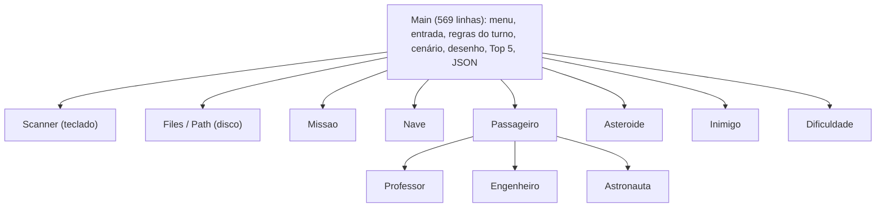
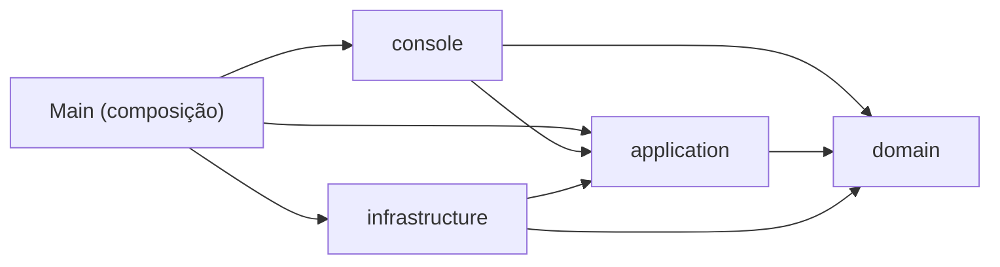
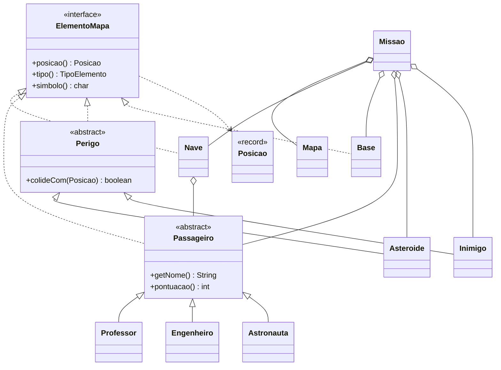

# Fase 1: tutorial da refatoração em camadas

Issue #7. Código: [`fases/fase-01-refatoracao/src/missaomarte/`](../src/missaomarte/). Como compilar e executar: [README da fase](../README.md). Análise de partida: [`docs/analise-inicial.md`](../../../docs/analise-inicial.md) e [`docs/fase-00-arquitetura.md`](../../../docs/fase-00-arquitetura.md). Contratos das classes: [`docs/contratos.md`](../../../docs/contratos.md).

Este tutorial conta o que havia na Fase 0, como o código foi reorganizado, quais princípios e padrões aparecem nas classes reais e o que ainda não está resolvido. Toda afirmação sobre o código cita a classe.

## 1. Problemas do código original e passo a passo da refatoração

### 1.1 Problemas da Fase 0

A Fase 0 (`fases/fase-00-console/src`) tinha um `Main.java` de 569 linhas com dez motivos para mudar (seção 1 de `docs/fase-00-arquitetura.md`). Os problemas que mais pesaram:

- **Regra de jogo presa ao terminal.** As regras do turno usavam `System.out` e `Scanner` dentro de `jogarPartida`; não dava para testá-las sem teclado.
- **Regra presa ao disco.** O Top 5 e o JSON do ranking (`loadRanking`, `saveRanking`, `parseRankingJson`) ficavam no mesmo arquivo que controlava a partida.
- **`instanceof` espalhado.** `criarPassageiroPolimorfico` e `desenharMapa` decidiam símbolo e tipo olhando a classe do passageiro; um tipo novo exigia editar dois lugares.
- **Parâmetros por dificuldade em `switch` e `if/else`** (`definirPontuacaoInicial` e as quantidades).
- **Conhecimento do mapa espalhado:** quatro inteiros de limites passados a quatro métodos e a base `(0,0)` repetida em três pontos.
- **Duplicação:** três laços de sorteio de célula e `colideCom` idêntico em `Asteroide` e `Inimigo`.
- **Aleatoriedade fixa:** `new Random()` criado no `Main`, o que torna a sorte parte de qualquer teste.

### 1.2 Passo a passo da refatoração

A ordem seguiu o sentido das dependências: do que não depende de nada para o que depende de tudo.

1. **`domain`.** Primeiro o que é regra pura, sem `Random`, sem entrada e sem saída: `Posicao`, `Direcao`, `Mapa`, `ElementoMapa`, `TipoElemento`, `Nave`, `Passageiro` (agora abstrata) com `Professor`, `Engenheiro` e `Astronauta`, `Perigo` com `Asteroide` e `Inimigo`, `Base` e `Missao`. Cada elemento passou a informar a própria posição e o próprio símbolo.
2. **`application`.** Em seguida, o que orquestra o domínio sem saber como a tela ou o disco funcionam: `Acao`, `Dificuldade` (com os parâmetros dentro do enum), `MissaoFactory`, `GameSession` (recebe uma `Acao` e devolve um `ResultadoTurno`), `RankingTop5` (a regra do Top 5) e a porta `RankingRepository`.
3. **`console` e `infrastructure`.** Por último, os detalhes: `JogoConsole`, `DesenhoMapa` e `MensagensConsole` cuidam do terminal e das frases; `FileRankingRepository` cuida do arquivo JSON e implementa `RankingRepository`.
4. **`Main` de composição.** O `Main` ficou só com a criação das dependências e a chamada de `executar()`.

O `Main` da Fase 1 inteiro (sem imports):

```java
public static void main(String[] args) {
    Scanner scanner = new Scanner(System.in);
    Random random = new Random();
    Clock clock = Clock.systemDefaultZone();
    FileRankingRepository repositorio = new FileRankingRepository(Paths.get("ranking.json"));
    RankingTop5 ranking = new RankingTop5(repositorio, clock);
    MissaoFactory fabrica = new MissaoFactory(random);
    GameSession sessao = new GameSession(fabrica, random, clock);
    new JogoConsole(scanner, System.out, sessao, ranking).executar();
}
```

Regra de dependência entre camadas: `domain` não importa outra camada; `application` importa só `domain`; `console` e `infrastructure` importam `application` e `domain`; só o `Main` enxerga todas. O `.workflow/check.sh` do projeto confere isso nos imports.

## 2. Responsabilidade: onde estava e onde ficou

Mapeamento a partir da tabela da seção 1 de `docs/fase-00-arquitetura.md`. "Onde estava" cita os métodos do `Main` da Fase 0.

| Responsabilidade | Onde estava (Fase 0) | Onde ficou (Fase 1) |
| --- | --- | --- |
| Composição e menu | `main`, `exibirBoasVindas`, `exibirMenu` | `Main` (só composição) e `JogoConsole` (menu) |
| Leitura e validação da entrada | `lerLinha`, `lerDificuldade`, `lerTamanhoMapa`, despacho do comando em `jogarPartida` | `JogoConsole` (leitura), `Acao.deTexto` (comando) e `Dificuldade.deString` (dificuldade) |
| Regras do turno | `jogarPartida` (embarque, movimento, inimigos, colisão, pontuação, vitória) | `GameSession.jogar` |
| Estado da partida (pontos, movimentos, tempo) | variáveis locais de `jogarPartida` | campos de `GameSession` |
| Parâmetros por dificuldade | `definirPontuacaoInicial` e quantidades | enum `Dificuldade` |
| Criação do cenário | `criarNovaMissao`, `criarPassageiroPolimorfico`, `posicaoOcupada` | `MissaoFactory` (sorteio) e `Missao.estaOcupada` (ocupação) |
| Desenho e mensagens | `desenharMapa`, `exibirEstatisticas`, `exibirRankingCompleto`, textos de `jogarPartida` | `DesenhoMapa`, `MensagensConsole` e `JogoConsole` |
| Regra do Top 5 | `isTopScore`, ordenação e corte | `RankingTop5` |
| Persistência do ranking | `loadRanking`, `saveRanking`, `parseRankingJson`, arquivo apagado em `resetarRanking` | `FileRankingRepository` (`infrastructure`), atrás da porta `RankingRepository` |
| Registro de uma entrada do ranking | classe interna `RankingEntry` | `RankingEntry` (record em `application`) |

## 3. SOLID

### S: responsabilidade única
- **Aplicação:** cada classe tem um motivo para mudar. `FileRankingRepository` só muda se o formato do arquivo mudar; `RankingTop5`, se a regra do Top 5 mudar; `DesenhoMapa`, se o desenho mudar; `GameSession`, se as regras do turno mudarem.
- **Limite:** `JogoConsole` ainda reúne menu, leitura, laço da partida e o registro no ranking (`exibirEstatisticasERegistrar`). É coeso por ser "a tela", mas é a classe mais próxima de acumular responsabilidades de novo.

### O: aberto para extensão, fechado para modificação
- **Aplicação:** uma nova dificuldade é uma constante nova no enum `Dificuldade`, com os cinco parâmetros no construtor; a `MissaoFactory` só lê os acessores (`passageiros()`, `asteroides()`, `inimigos()`, `capacidadeNave()`). `DesenhoMapa.simboloEm` e `Missao.elementos()`/`estaOcupada` trabalham com `ElementoMapa`, e um passageiro novo é uma subclasse de `Passageiro` que entra por `Missao.adicionarPassageiro`, sem mudar essas classes.
- **Limite:** o `switch` de `Acao.deTexto`, o de `MissaoFactory.criarPassageiro` (por `indice % 5`) e o de `MensagensConsole.traduzir` continuam fechados por modificação. Um tipo novo de elemento também exige editar `TipoElemento` (seção 7). Um perigo novo exige editar `Missao` (lista própria, método `adicionar...`, `haColisao` e `elementos`), porque a `Missao` separa `asteroides` e `inimigos` para mover só os inimigos, além de `MissaoFactory` e `Dificuldade`.

### L: substituição de Liskov
- **Aplicação:** `Professor`, `Engenheiro` e `Astronauta` entram onde há um `Passageiro`: `Nave.embarcar(Passageiro)` e `Missao.embarcar(Passageiro)` não distinguem o subtipo, e cada subclasse só implementa `pontuacao()` e `tipo()`. `Asteroide` e `Inimigo` herdam o mesmo `colideCom` de `Perigo`, e com isso a duplicação da Fase 0 sumiu (`Missao.haColisao` o chama nas listas concretas).
- **Limite:** `Inimigo` tem `mover`, que `Asteroide` não tem. Quem recebe um `Perigo` não pode mover; por isso `Missao` guarda as duas listas separadas (`asteroides` e `inimigos`).

### I: segregação de interfaces
- **Aplicação:** `RankingRepository` tem só três operações (`carregar`, `salvar`, `limpar`), as que `RankingTop5` usa. `ElementoMapa` tem só o que o desenho e a colisão precisam: `posicao()`, `tipo()` e o `simbolo()` derivado.
- **Limite:** são interfaces pequenas, mas poucas. `GameSession` e `Missao` são classes concretas expostas direto ao console (`JogoConsole` e `DesenhoMapa` leem os contadores da `Missao`), sem uma interface só de consulta.

### D: inversão de dependência
- **Aplicação:** `RankingTop5` depende da interface `RankingRepository` (em `application`), não de `Files` e `Path`; quem implementa é `FileRankingRepository`, em `infrastructure`, e o `Main` liga as duas. `GameSession` e `MissaoFactory` recebem o `Random`, e `GameSession` e `RankingTop5` recebem o `Clock`, em vez de criá-los.
- **Limite:** `JogoConsole` depende das classes concretas `GameSession` e `RankingTop5`, não de interfaces. Para a escala do projeto, a inversão que importa (disco, sorteio e relógio) está feita.

## 4. GRASP

| Padrão | Classe(s) | Justificativa |
| --- | --- | --- |
| Controller | `GameSession` | Recebe a `Acao` vinda da interface e coordena o turno (move a nave, desembarca, move inimigos, trata colisão, decide vitória ou derrota), sem tocar em `System.out`. |
| Information Expert | `Missao`, `Nave`, `Mapa` | Quem tem os dados faz a conta: `Missao` conta `getABordo()`, `getEntregues()` e `getRestantes()` a partir das próprias listas e decide `todosEntregues()` e `haColisao()`; `Nave` sabe se `estaCheia()`; `Mapa` responde `contem(Posicao)`. |
| Creator | `MissaoFactory` | Tem os dados para montar a `Missao` (a `Dificuldade` e o `Random`) e é quem a cria com a nave, os passageiros e os perigos. |
| Low Coupling | `RankingRepository` | `RankingTop5` conhece só a interface; trocar o arquivo por outro armazenamento não altera a regra do Top 5. |
| Polymorphism | `Passageiro` e `ElementoMapa` | Cada passageiro responde a própria `pontuacao()` e o próprio `tipo()`; o desenho chama `elemento.simbolo()` sem `instanceof`. Substituiu os `instanceof` da Fase 0. |
| Pure Fabrication | `FileRankingRepository` | Não representa um conceito do jogo; existe para concentrar a persistência e manter `domain` e `application` sem E/S. |
| High Cohesion | `Dificuldade` | Reúne em um só lugar tudo o que muda por nível, em vez de espalhar por condicionais. |

## 5. Padrões de projeto

### 5.1 Factory (`MissaoFactory`)

Esconde como o cenário é montado. O restante do código pede `criar(dificuldade, tamanho)` e recebe uma `Missao` pronta:

```java
public Missao criar(Dificuldade dificuldade, int tamanho) {
    Mapa mapa = new Mapa(tamanho);
    Missao missao = new Missao(mapa, new Nave(dificuldade.capacidadeNave()));
    for (int i = 0; i < dificuldade.passageiros(); i++) {
        missao.adicionarPassageiro(criarPassageiro(i, sortearCelulaLivre(missao, mapa)));
    }
    // asteroides e inimigos: o mesmo laço, com sortearCelulaLivre
    return missao;
}
```

Um único sorteio de célula livre (`sortearCelulaLivre`) substituiu os três laços duplicados da Fase 0.

### 5.2 Repository (`RankingRepository` e `FileRankingRepository`)

A porta fica na `application`; a implementação, na `infrastructure`:

```java
public interface RankingRepository {
    List<RankingEntry> carregar();
    void salvar(List<RankingEntry> entradas);
    void limpar();
}

public class FileRankingRepository implements RankingRepository { /* JSON manual em ranking.json */ }
```

### 5.3 Value Object (`Posicao`)

`Posicao` é um `record` imutável; mover devolve outra instância e a igualdade é por valor:

```java
public record Posicao(int x, int y) {
    public static final Posicao ORIGEM = new Posicao(0, 0);

    public Posicao mover(Direcao direcao) {
        return new Posicao(x + direcao.dx(), y + direcao.dy());
    }
}
```

Por isso `Missao.desembarcarNaBase` compara `nave.posicao().equals(base.posicao())` sem se preocupar com referência.

### 5.4 Injeção de Dependência (`Main`)

As dependências são criadas no `Main` e entregues por construtor (trecho na seção 1.2): `new MissaoFactory(random)`, `new GameSession(fabrica, random, clock)`, `new RankingTop5(repositorio, clock)`. É injeção manual, sem framework. Permite, por exemplo, passar um `Random` com semente ou um `Clock` fixo.

### 5.5 O que não é Strategy

Dois pontos parecem Strategy, mas não são:

- O `switch` de `Acao.deTexto` é uma tabela de conversão de tecla em constante do enum. Não há uma família de algoritmos intercambiáveis atrás de uma interface.
- Os valores da `Dificuldade` são dados por constante (pontuação, quantidades, capacidade), não comportamentos diferentes. A `MissaoFactory` executa o mesmo algoritmo com números diferentes.

## 6. Diagramas

### 6.1 Arquitetura antes (Fase 0)



O `Main` conhece todas as classes do jogo e fala direto com o teclado e com o disco.

### 6.2 Dependências entre camadas (Fase 1)



### 6.3 Classes do domínio



## 7. Limitações reais e como resolver

Todas estão registradas nas specs concluídas (`specs/done/fase1-*`) e em `docs/contratos.md`.

| # | Limitação | Onde | Como resolver |
| --- | --- | --- | --- |
| 1 | **Tamanho 1 no Médio ou no Difícil trava a criação do cenário** (ponto *d* da Fase 0). Com tamanho 1 o mapa tem 9 células, 8 livres fora da base; o Médio pede 9 objetos e o Difícil 11, e `sortearCelulaLivre` repete para sempre. | `MissaoFactory.sortearCelulaLivre` | Antes do laço, comparar a quantidade de objetos com as células livres e recusar o tamanho (por exemplo, um tamanho mínimo por dificuldade em `GameSession.iniciar`) ou lançar uma exceção. Muda comportamento, então precisa de spec. |
| 2 | **Tipo novo de elemento exige constante nova em `TipoElemento`.** O símbolo e o nome ficam no enum, então a subclasse nova de `Passageiro` ou `Perigo` não basta. | `TipoElemento`, `ElementoMapa.tipo()` | Deixar símbolo e nome numa descrição própria de cada elemento em vez de um enum fechado; ou aceitar o custo de editar um único arquivo, que é o desenho atual. |
| 3 | **`GameSession` sem guarda.** `jogar` continua aceitando ações depois do fim da partida; `getVidas`, `resumo` e os demais getters que usam a missão falham com `NullPointerException` antes de `iniciar` (a missão ainda é nula). | `GameSession` | Lançar `IllegalStateException` em `jogar` quando `isEncerrada()` e nos getters quando não houve `iniciar`; ou modelar o estado com um valor `NAO_INICIADA`. Hoje só o `JogoConsole` usa a sessão e respeita a ordem. |
| 4 | **Nome com vírgula some do ranking, sem aviso** (ponto *b*). O JSON é escrito e lido à mão e a leitura quebra nas vírgulas. | `FileRankingRepository` (`interpretar`) | Escapar vírgulas e aspas ao gravar e desfazer o escape ao ler, ou adotar uma biblioteca de JSON (dependência nova, fora do escopo da Fase 1). |
| 5 | **O menu só aparece depois da primeira linha lida** (ponto *a*): o laço de `JogoConsole.executar` testa `scanner.hasNextLine()` antes de `exibirMenu`, e a primeira linha digitada vira a opção. | `JogoConsole.executar` | Mostrar o menu antes de bloquear na leitura e tratar o fim da entrada depois. Preservado de propósito para manter o comportamento da Fase 0. |

Outras observações dos relatórios das specs, sem urgência: `MensagensConsole.traduzir` tem `default: break;`, então um `TipoEvento` novo passaria sem frase; o `JogoConsole` repete a guarda `recorde > 0` do recorde fora da `application`; os caminhos de erro de E/S do ranking ("Erro ao resetar ranking" e "Não foi possível salvar o ranking") foram exercitados com falha provocada nas revisões das specs, não no roteiro manual.

## 8. Mudanças de comportamento em relação ao original

Quatro mudanças intencionais, listadas no [README da fase](../README.md). O resto (frases, ordem das checagens, ranking, pontos de atenção *a*, *b*, *c* e *d*) foi preservado.

1. **Desembarque automático na base.** Ao chegar a `(0,0)` com passageiros a bordo, eles são entregues (`Missao.desembarcarNaBase`, chamado em `GameSession.jogar` depois do movimento), com a frase `N passageiro(s) entregue(s) na base!` (evento `ENTREGA`).
2. **Vitória só com todos entregues.** `GameSession.jogar` usa `missao.todosEntregues()`; embarcar o último não basta, é preciso levá-lo à base. Na Fase 0 bastava embarcar todos.
3. **Linha de status com "Entregues".** `DesenhoMapa.linhaStatus` mostra `Nave em (x,y) | Pontos: p | Vidas: v | A bordo: b/capacidade | Entregues: e/total | Restantes: r`, com a conta a bordo + entregues + restantes = total.
4. **Capacidade por dificuldade: 4 (Fácil), 3 (Médio) e 2 (Difícil).** Vem de `Dificuldade.capacidadeNave()`; na Fase 0 era 5 fixa e "Nave cheia!" era inalcançável (ponto *e*).

## 9. Roteiro de testes manuais

Execute em `fases/fase-01-refatoracao`, com `./build.sh run`. Apague o `ranking.json` local antes, para começar sem registros. Depois de cada ação, o menu só aparece depois da próxima linha lida (ponto *a*). A coluna "Resultado" está **em branco de propósito**: quem executa o roteiro a preenche (OK, falhou, observação). O QA manual das specs da Fase 1 foi adiado para este ponto.

| # | Caso | Passos | Esperado | Resultado |
| --- | --- | --- | --- | --- |
| 1 | Menu: opção válida | Abrir o jogo e digitar `2` com o ranking vazio | Boas-vindas "MISSÃO MARTE UNIFOR - VERSÃO 10.0", menu de 4 opções e " - Nenhum registro encontrado. Seja o primeiro a jogar!" | |
| 2 | Menu: opção inválida | Digitar `9` no menu | "Opção inválida. Tente novamente."; o menu volta depois da próxima linha digitada (ponto *a*) | |
| 3 | Dificuldade Fácil | Opção `1`, nome vazio, `facil`, tamanho `abc`, Enter | "Entrada inválida, usando tamanho padrão (5).", piloto "Piloto Anônimo" e `Pontos: 30 ... A bordo: 0/4 ... Entregues: 0/4 ... Restantes: 4` | |
| 4 | Dificuldade Média | Nova missão com `medio` | `Pontos: 20` e `A bordo: 0/3 ... Restantes: 5` | |
| 5 | Dificuldade Difícil | Nova missão com `dificil` | `Pontos: 45` e `A bordo: 0/2 ... Restantes: 5` | |
| 6 | Embarcar sem passageiro | `c` na origem | "Nenhum passageiro nesta posição." | |
| 7 | Embarcar com passageiro | Ir até um passageiro e digitar `c` | "Passageiro <nome> embarcado com sucesso! +<10/15/20> pontos!"; "A bordo" sobe e "Restantes" desce | |
| 8 | Nave cheia | No `dificil`, embarcar 2 passageiros e tentar o 3º | "Nave cheia! Não há espaço para mais passageiros." | |
| 9 | Entregar na base | Voltar a `(0,0)` com passageiro a bordo | "N passageiro(s) entregue(s) na base!"; "A bordo" zera e "Entregues" sobe; a bordo + entregues + restantes = total em toda linha | |
| 10 | Aviso de retorno | Embarcar todos os restantes e ficar fora da base | "ALERTA: Todos os passageiros resgatados! Retorne para a Plataforma de Pouso 'L' em (0,0)..." a cada turno | |
| 11 | Vencer | Entregar o último passageiro na base | Bloco de vitória, estatísticas com "Passageiros Resgatados" = entregues e `ranking.json` criado; a vitória só vem depois da entrega | |
| 12 | Colidir | Entrar na célula de `#` ou `X` | "Alerta! Colisão detectada! Vidas restantes: 2"; na 3ª colisão, "GAME OVER! A nave foi destruída." | |
| 13 | Pontuação zerada | Andar até os pontos acabarem | "Combustível/Pontuação zerada! Missão perdida." | |
| 14 | Gravar no ranking | Vencer com pontuação positiva | "Parabéns! Você entrou para o Top 5 de pilotos!" | |
| 15 | Consultar ranking | Opção `2` depois de vencer | Entradas por pontuação decrescente: `1. Nome - P pts \| Dificuldade: ... \| Coletados: N \| Tempo: Ts \| <data>` | |
| 16 | Limpar ranking | Opção `3` com `n`; depois opção `3` com `s` | "Operação cancelada." e depois "Ranking resetado com sucesso!", com `ranking.json` apagado | |
| 17 | Sair com `Q` | `q` durante a partida | "Missão abortada pelo piloto." e volta ao menu | |
| 18 | Opção de sair | Opção `4` no menu | "Obrigado por jogar a Missão Marte Unifor!" e o programa encerra | |
| 19 | Fim da entrada (Ctrl+D) | Três execuções separadas, pois o primeiro Ctrl+D fecha a entrada: Ctrl+D no menu; Ctrl+D antes de decolar; Ctrl+D durante a partida | "Entrada encerrada. Obrigado por jogar!", "Entrada encerrada. Missão não iniciada." e "Entrada encerrada. Missão abortada." (na terceira, ao voltar ao menu, também "Entrada encerrada. Obrigado por jogar!") | |
| 20 | Comandos inválidos | `z` e linha vazia durante a partida | "Comando inválido." para `z`; a linha vazia só pede novo comando | |
| 21 | Compatibilidade do ranking | Vencer na Fase 0 e abrir o ranking na Fase 1, na mesma pasta; depois o inverso | Cada fase lê o `ranking.json` gravado pela outra | |
